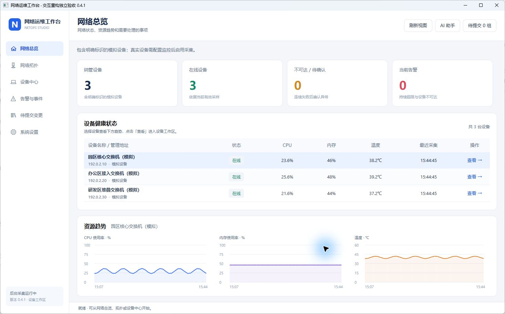
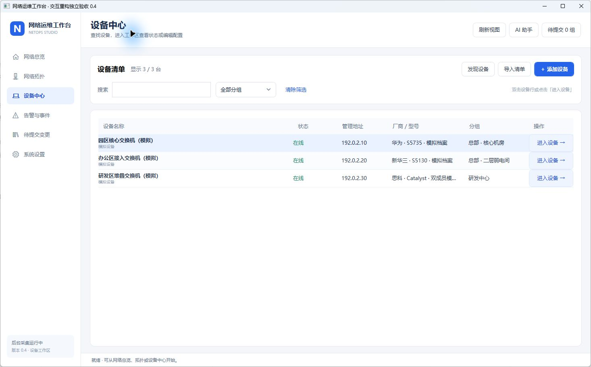
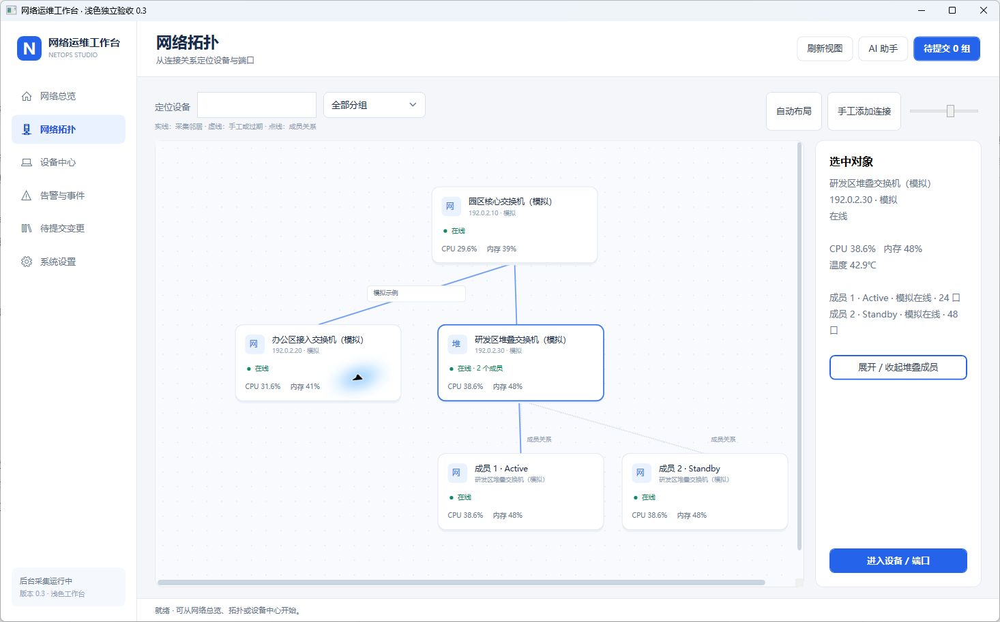
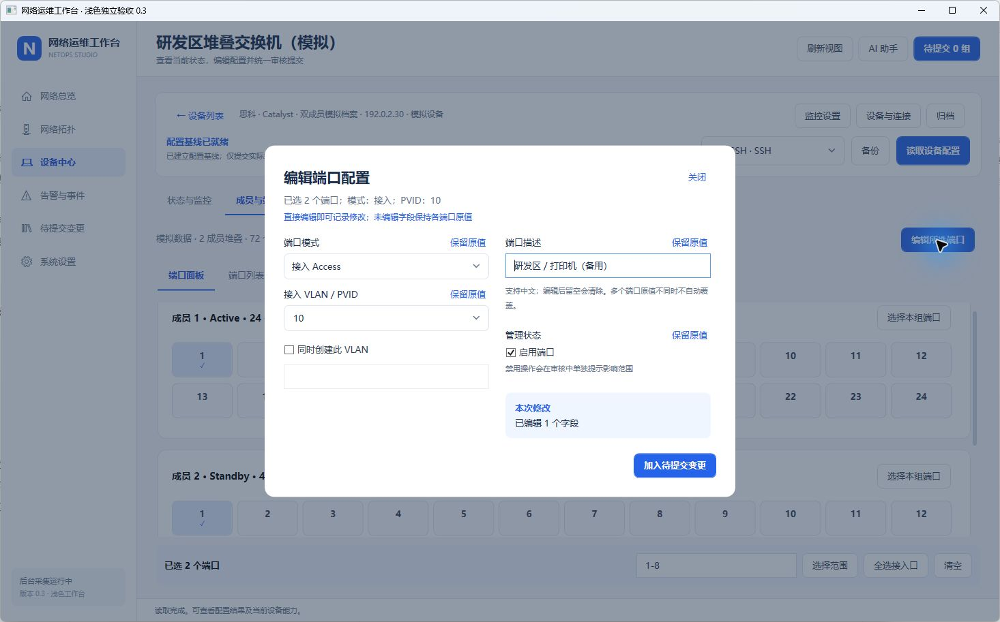
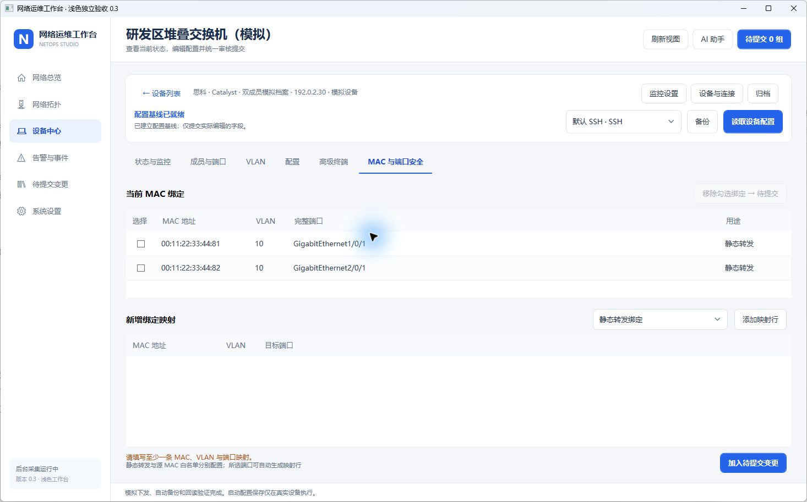
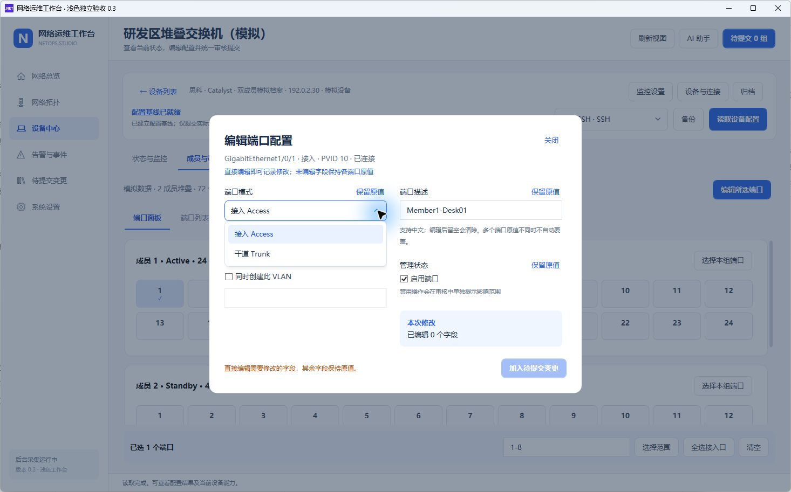

# 网络运维工作台 · NetOps Studio

C# / .NET 10 / WPF 中文 Windows 桌面工具，将交换机日常配置、网络拓扑、设备监控与 AI 辅助排障放在同一个浅色工作台中。

**当前源码：0.7.0 开发预览 · Windows x64 · Public 公开仓库**

0.7.0 改为直接操作端口：**左侧点端口，右侧编辑，检查后确认应用**。常用操作不再经过任务卡和多步向导。MAC 页展示全部原有地址，明确选择保留或移除，再输入新地址；始终显示“原有－移除＋新增＝最终名单”，审核同时展示完整前后名单。网络管理和备份记录也有固定入口。最新已发行下载包仍为 **0.5.0**，不包含本轮界面；体验新版请从源码运行或本地打包。

[下载已发行的 0.5.0 Windows 包](https://github.com/saohuaLee/switch-tools/releases/download/v0.5.0/NetOpsStudio-v0.5.0-win-x64.zip) · [0.5.0 发布页](https://github.com/saohuaLee/switch-tools/releases/tag/v0.5.0) · [SHA256 校验文件](https://github.com/saohuaLee/switch-tools/releases/download/v0.5.0/SHA256SUMS.txt)

[界面预览](#界面预览) · [功能清单](#本版功能) · [启动与验证](#启动与验证) · [配置步骤](#端口与堆叠操作) · [需求与兼容范围](docs/原方案需求对照.md)

当前包含四家实验性图形化配置驱动；真实设备兼容性尚未做真机认证。下方截图来自独立模拟工作区，显示的设备、连接、指标与 MAC 均为示例。

第一次使用建议按下面操作：

1. 在“我的交换机”点击“添加交换机”，在同一张表填写名称、管理 IP、厂商和连接账户；默认添加真实设备。只想熟悉软件时，明确勾选“练习设备”。
2. 点击某台交换机的“进入端口”。首次先点击“连接并读取端口”。
3. 在左侧点选目标端口。右侧“端口信息”可直接改名称、所属网络和开关；“MAC 绑定名单”用于编辑接入名单。
4. MAC 页逐条列出旧地址：勾选表示保留，取消勾选表示应用时移除。新地址每行一个；只想使用新地址时，点击“只用下面的新地址”，再填写。原来两条再新增一条会明确显示保留 2、新增 1、最终 3，不会隐藏旧地址。
5. 点击“检查并应用本页修改”，核对前后值或完整名单，确认后才会备份、执行、回读和保存。结果留在原页面；切换端口可保留各自未应用的填写。

详细操作与限制见 [0.7 端口工作台](docs/0.7端口工作台.md)。网络管理、备份记录和运行状态在设备页顶部；“连接与监控”管理当前设备的登录和监控；“更多端口功能”包含命令终端、完整批量端口配置和静态转发；右上角“工具与设置”包含 AI、批量草稿和系统设置。


上图为 0.7 独立练习工作区，设备与地址均为示例。原有地址、输入数量与最终名单在同一页展示。


上图为历史 0.4 界面，以下 0.6 / 0.4 / 0.3 截图用于说明保留能力及历史设计，不代表 0.7 常用操作布局。

## 界面预览

### 0.7 常用页面的操作入口

| 你想做什么 | 从哪里开始 |
| --- | --- |
| 添加交换机 | 我的交换机 → 添加交换机，一页填写资料和账户 |
| 改端口名称、网络或开关 | 进入端口 → 左侧点端口 → 右侧端口信息 |
| 绑定、更换或取消 MAC | 同一端口右侧 MAC 绑定名单，勾选保留旧地址、填写新地址 |
| 建立或改名 VLAN | 设备页顶部网络（VLAN），左侧选择、右侧修改 |
| 备份、查看副本和操作结果 | 设备页顶部备份与记录；配置比较按需展开 |
| 配置监控账户 | 当前设备右上方连接与监控 → 监控设置 |
| 看设备状态或连接关系 | 左侧查看运行状态 / 查看连接关系 |
| AI 分析或批量草稿 | 右上角工具与设置 |

添加设备的资料和账户在同一表单；型号、位置和高级连接参数按需展开。监控的告警阈值、自定义指标也按需展开，保存按钮固定在底部。AI 分析明确标出选服务、查看资料、填写问题三个操作，未配置服务时可直接跳到设置；AI 设置的保存按钮固定在底部。


### 0.4.1 网络总览表格排版

设备名称列设置宽度上限，状态、CPU、内存、温度与采集时间按比例分配空间，避免宽窗口中名称列独占大半张表。设备名称与管理地址左对齐，指标表头及数值居中对齐；每行显示地址和数据来源，并提供独立的「查看」入口。选中行仍更新下方趋势，双击行也可进入工作区。



### 0.4 设备工作区：先定位，再配置，最后审核

设备页左上角固定显示带底色和边框的 **「← 返回设备列表」** 按钮，支持 **Alt+←**；点击左侧「设备中心」也会回到列表。返回时保留搜索、分组、端口选择、编辑草稿与待提交变更。列表支持名称、地址、厂商、型号及分组组合筛选，并提供明确的「进入设备」按钮和空结果提示。

工作区按 **固定导航 → 设备身份与监控状态 → 连接配置与读取 → 功能页，按设备统一审核** 分层。读取前提示下一步，读取后入口改为「重新读取配置」。运行状态优先展示 CPU、内存、温度与趋势，成员、传感器和档案详情按需展开。设备编辑、监控与归档收拢到「设备管理」菜单，备份集中在「配置备份」页。



0.7 常用操作直接在端口列表右侧编辑，批量草稿在高级入口中单独审核。普通操作既不执行其他草稿，也不因本次成功而清空它们；设备状态改变后，原草稿需重新核对基线。

### 从拓扑定位设备与堆叠成员

支持设备搜索、分组、缩放、拖动与布局保存。选择节点查看设备信息，展开堆叠查看成员；从连接详情可跳转至设备及本地端口。自动邻居来自 LLDP/CDP，手工连接和过期记录另有标识。



图中点线表示成员关系；邻居连接尚不代表实时端口运行状态或流量。

### 高级功能：跨成员选择端口，编辑指定字段

先读取设备配置，再逐口、按范围或按成员选择端口，选好后点击“编辑所选端口”。直接编辑描述、模式、PVID、允许 VLAN 或管理状态；未编辑字段保留各端口原值，点击“保留原值”可撤销对应字段的修改。



高级端口编辑仍可直接审核；相同于原值的字段会被剔除，避免初始化的模式或 PVID 误加入请求。“存为批量草稿”仅记录草稿，审核前不会下发命令。日常操作直接使用端口工作台。

### MAC 地址逐行映射，提交后查看回读结果

在表格填写 MAC、VLAN 和完整端口名称，也可以从所选端口生成映射行。下图为两条静态转发绑定的模拟回读结果，分别对应成员 1 和成员 2 的端口。



静态转发绑定和源 MAC 白名单用途不同，支持范围及限制见 [MAC 绑定](#mac-绑定)。

<details>
<summary>查看浅色下拉菜单与控件细节</summary>

下拉框采用白色圆角表面、浅蓝选中项和蓝色焦点提示；可输入 VLAN 的下拉框仍支持直接编辑。滚动条统一为细圆角样式，保留滚轮、拖动及横向滚动。



</details>

更多运行记录见 [桌面与自动验证](docs/验证记录.md)，本次交互调整见 [0.4 交互重构](docs/0.4交互重构.md)，底层功能设计见 [0.3 重构设计](docs/0.3重构设计.md)。

## 本版功能

| 功能 | 当前实现 |
| --- | --- |
| 端口工作台 | 左侧单击端口，右侧直接编辑“端口信息 / MAC 绑定名单”；固定计数与应用按钮，中文审核，结果留在当前页；不再先选任务和多步跳转 |
| 高级批量草稿 | 端口、VLAN、MAC 可跨页面累计，在高级入口独立审核；普通操作不夹带、不清空其他草稿；仅清理实际执行的草稿 |
| 可视化拓扑 | SNMP LLDP、SSH LLDP/CDP 邻居；两端接口、未知邻居、手工连接、搜索/分组、缩放、拖动与布局保存；堆叠成员展开 |
| 设备监控 | SNMPv3 / 显式 SNMPv2c / SSH 只读采集在线状态、CPU、内存、温度；趋势、持续告警、确认与恢复；独立后台进程 |
| 设备管理 | 两步添加：设备身份 → 连接账户；明确区分真实与练习；搜索/分组、编辑、归档和多连接配置保留 |
| 设备清单 | 选择 CSV / XLSX → 预览 → 确认；提供 CSV 填写示例，整批校验和事务提交；不导入密码、不运行公式 |
| 主动发现 | 指定 IPv4 范围与一个 TCP 端口，最多 256 个地址，可取消；端口可达不等于设备识别 |
| 连接 | SSH 交互 Shell（密码/私钥、可信指纹）、Console 串口、显式允许的 Telnet；NETCONF get-config、RESTCONF/厂商 HTTP API GET 只读接入 |
| 端口 | 从真实接口清单识别物理端口；按成员分组，范围/整成员/逐口选择；批量编辑模式、PVID、允许 VLAN、启停和描述 |
| 中文描述 | 在端口信息直接填写或清空，只提交与原值有差异的字段；批量编辑保留在高级入口 |
| 保留绑定换网络 | Cisco 已适配接入口可在同一次关口期间迁移全部普通静态安全 MAC，保留数量上限、违规动作和原启停状态；未适配安全配置会拦截 |
| 交换机堆叠 | 读取 Huawei iStack、H3C IRF、Cisco 堆叠、锐捷 VSU 成员和角色；按接口清单计数，不用固定 24 口推断真实设备 |
| VLAN | 左侧选网络，右侧改名或删除；创建有独立按钮；引用保护、分配时同步创建及高级成员矩阵保留 |
| MAC 地址绑定 | 完整旧名单逐条选择保留 / 移除，新增支持批量粘贴和格式整理；分开统计原有、保留、新增、移除与最终数量；可自动或手动上限，三种中文违规动作；静态转发在高级入口 |
| 变更闭环 | 一次性审核计划、10 分钟有效、基线与设备身份复核、变更前加密备份、逐条执行、失败停止、英文命令配中文解释；常用流程默认回读通过后保存，高级普通变更可选保存，安全变更强制保存 |
| 高级终端 | SSH / Console / Telnet 手动命令、内存历史、隐藏输入；为行式交互终端，不是完整终端仿真器 |
| 配置中心 | 加密备份、历史查看、模拟配置逐行比较；没有已验证的自动恢复或回滚 |
| AI | 五类文本协议、自定义服务/模型、默认配置、上下文核对、取消；等待时可浏览，保留编辑草稿 |

四个实验性图形化驱动按 **VRP / Comware / IOS / IOS XE / RGOS 系统系列**区分，不把所有同品牌设备视作兼容。真实配置闭环已通过会话夹具验证，**尚未做真机认证**。Console/Telnet 当前用于手动终端；NETCONF/RESTCONF/API 的通用只读能力不等于厂商完整图形化适配。

完整需求与未完成项见 [原方案需求对照](docs/原方案需求对照.md)。Hybrid/Voice VLAN、速率/双工、聚合、三层、ACL/NAT、自动化及更完整的厂商监控适配仍在后续范围；不会标成已完成。

## 启动与验证

### 下载发行包

从上方 GitHub 发布页下载 `NetOpsStudio-v0.5.0-win-x64.zip`，解压后运行 `NetOpsStudio.exe`。程序包包含运行时，面向 Windows x64，无需预装 .NET；不会附带开发者的设备数据库、连接凭据或本地配置。详细变更与当前验证边界见 [0.5.0 发布说明](docs/发布说明-v0.5.0.md)。

可用以下命令计算下载包的 SHA256，与发布页的 `SHA256SUMS.txt` 对照：

```powershell
Get-FileHash .\NetOpsStudio-v0.5.0-win-x64.zip -Algorithm SHA256
```

### 从源码运行

要求 Windows x64；开发需要 .NET 10 SDK。脚本优先使用 `%LOCALAPPDATA%\NetOpsStudio\dotnet` 的本地 SDK，否则使用系统 SDK。

```powershell
.\tools\启动.ps1
.\tools\启动.ps1 -数据目录 'D:\独立测试数据'
.\tools\验证.ps1
.\tools\打包.ps1
```

打包输出：`artifacts/应用-v0.7.0/NetOpsStudio.exe`，包含运行时。验证构建使用独立目录，不覆盖正在运行的开发构建。普通依赖与发布依赖分别使用 `packages.lock.json`、`packages.publish.lock.json`；发布锁使用 SDK 10.0.403 生成。

默认数据目录 `%LOCALAPPDATA%\NetOpsStudio\data`。首次创建工作区生成三台模拟设备，第三台为 **24 + 48 口的双成员堆叠示例**。已有数据保持原样，不覆盖旧示例或用户配置；体验新堆叠示例可指定新的数据目录。

## 端口与堆叠操作

常用操作点击设备的“进入端口”，读取后直接单击左侧端口。右侧“端口信息”初始显示当前名称、网络和开关，改哪项就只提交哪项；所属网络与名称、启停可以在同一次确认中修改，不必切换多个任务。未应用的填写按端口保留，切换端口不会混入本次执行；重新读取发现配置变化时会提示重新核对。

更换网络选择已有 VLAN，或勾选同步创建并填写编号。VLAN 不会自动配置终端 IP、网关或 DHCP。已有普通静态安全绑定的 Cisco 接入口会保留绑定同步迁移；sticky、认证、voice、静态转发等不能自动推断的配置会拦截。迁移保留原上限、违规动作及原启停状态；显式修改的端口开关再按填写值处理。

完整端口配置放在菜单底部“高级功能”。需要模式、干道允许列表或按范围跨成员操作时：

1. 进入“完整端口设置”，先读取配置，查看角色及实际采集的端口数。
2. 逐口选中、选择整个成员，或输入范围。多槽位/成员必须使用完整名称，例如：

```text
GigabitEthernet1/0/1-8,GigabitEthernet2/0/1-8
```

3. 点击“编辑所选端口”，只改需要的字段，相同于原值的设置不会提交；点击“保留原值”可撤销对应字段。描述应用上限为 128 个 UTF-8 字节，不接收换行、控制字符、分号或竖线。设备本身的长度和字符编码限制仍需真机验证。
4. 点击“下一步：审核并执行”，核对差异和命令。需要多项配置一起提交时先存为批量草稿，再从高级入口单独审核。真实设备执行前重新采集基线、堆叠和端口清单，成员身份 / 角色 / 接口变化会停止下发。

端口数为设备返回接口清单中的物理接口数量，包含已列出的业务口与上联口，排除 VLAN/聚合/子接口等逻辑接口；不等于根据型号推算的面板容量。未取得接口清单时仅展示配置中端口，**总数未确认**；未取得堆叠信息时显示未识别，不能认定是单机。离线成员数量未知，不能凭空生成可操作端口。当前适配固定式成员的常见编号；机框 CSS、特殊编号、VSF 等输出仍需扩展。

## MAC 绑定

进入端口后点击右侧“MAC 绑定名单”。原有静态安全地址全部列出，默认勾选保留；取消勾选只代表待移除，确认前不会改变交换机。新增地址每行一条。想把所有旧设备换成新设备，点击“只用下面的新地址”；也可以只取消保留某一个旧地址，再输入替换地址。

固定区域分开显示原有、保留、移除、输入、新增和应用后数量。例如旧 2 条＋新 1 条，在全部保留时最终 3 条；取消保留两条旧地址后最终 1 条。与旧名单重复的输入不计为新增。默认按最终名单自动设置上限；手动上限不足时显示来源和“按名单自动设置”的修正入口。审核并排展示完整的原名单和目标名单，成功后留在本页显示实际回读名单。

普通绑定适用于已适配 Cisco 接入口；静态转发在“高级工具”，用途不同。高级批量输入也支持每行完整映射：

```text
00:11:22:33:44:55,10,GigabitEthernet1/0/1
0011-2233-4466,10,GigabitEthernet2/0/1
```

- **格式整理**：接受 `38-ff-59-06-1a-71`、`38:ff:59:06:1a:71`、`38ff.5906.1a71`、连续 12 位、空格及对应全角字符。离开单元格、导入及加入待提交时整理为冒号格式；Cisco 下发统一为 `38ff.5906.1a71`。缺位、非法字符、全零、广播、组播与注入输入被拒绝，不猜测地址。
- **自动上限（默认）**：按每个端口的最终绑定数计算，包含已有且保留的绑定，扣除旧 MAC 后加入新 MAC；单条为 `1`，多条自动增加。可关闭自动模式手动填正整数，不能低于最终静态绑定数。手动上限大于静态绑定数时，剩余名额可动态学习其他 MAC，不再是严格白名单，审核会提示。本版每端口最多编辑 64 条静态安全绑定，实际资源上限以设备型号为准。
- **违规动作下拉框**：`shutdown`（默认，违规使整个端口错误禁用）、`restrict`（丢弃违规报文并记录 / 告警）、`protect`（仅丢弃违规报文，不作此类违规通知），同时显示英文和中文。按 VLAN 关闭等扩展动作尚未适配。
- **直接换绑**：取消保留待替换的旧地址，再填写新地址；只替换一个时，其余旧地址继续勾选保留。安全操作按 `shutdown` → 删除旧 MAC → `switchport mode access` → 设置端口安全、上限及违规动作 → 添加新 MAC → `no shutdown` → 回读验证 → `write memory` 执行，最终启用端口，即使原先已禁用。最后一条删除后关闭端口安全；这是取消接入限制，不能替代关闭端口。高级批量草稿中相邻且仅涉及端口安全的项会合并，避免反复关开口；夹有其他配置组时按组顺序执行。多端口先删除所有涉及的旧绑定再添加新绑定。
- **保存与异常**：安全变更回读通过后自动保存到设备启动配置，不受通用可选保存开关影响。审核表逐条并列显示英文命令和中文解释，保存标为回读通过后的步骤。命令被拒绝或回读不符时停止且不保存；失败可能部分生效、端口可能保持关闭，不自动重试或回滚。保存命令失败报告“保存未确认”。不以固定等待 5 秒代替验证。
- **支持范围**：端口安全仅 Cisco IOS / IOS XE 明确的 Access 接入口；可调整普通静态绑定和三种已适配策略，遇到 sticky、voice、认证、聚合及其他未适配安全选项会拦截。动态运行表不在配置回读核验范围内，动态项导致设备拒绝静态绑定时需在终端核对，不自动清空全局表项。其他厂商端口安全、IP+MAC 绑定仍需适配。
- **静态转发绑定**：指定目的 MAC 在 VLAN 的出口，支持四个实验性驱动，不限制源 MAC 接入。所有绑定仍校验 VLAN 成员、端口、重复映射和冲突，并走预览、备份、确认、执行、回读与审计。

锁定依赖 Release 构建无警告、无错误，148 项检查通过，新增覆盖原有两条再输入一条的数量来源、只用一个新地址后实际仅剩一条、手动上限修正、完整名单审核、端口切换保留填写、仅应用当前页、名称 / 网络 / 开关同页修改及实际 WPF 布局。尚未完成真实交换机兼容性与终端通断认证。详见 [0.7 端口工作台](docs/0.7端口工作台.md)。

## 拓扑与监控

在设备工作区打开“监控设置”。真实设备需明确启用：推荐 SNMPv3 SHA256 + AES128，也可明确选择旧设备的 SHA1 或 SNMPv2c；SSH 使用所选 SSH 连接档案及可信指纹。凭据仅保存在本机 DPAPI 中。

- 轮询间隔 15–3600 秒，连续 2–10 次管理探测失败后确认不可达。Ping 被禁而 SNMP/SSH 可用时仍可判断在线；指标采集失败与设备不可达分别记录。
- 标准 CPU/物理内存来自 HOST-RESOURCES-MIB，温度来自 ENTITY-SENSOR-MIB，保留单位、精度、传感器与质量。设备不支持标准表时，可填写已确认的数值 OID，或使用 SSH 的厂商只读命令。高级 OID 目前要求设备直接返回百分比/摄氏度，不自动换算厂商私有单位。
- CPU/内存默认阈值 85%/90%，持续次数可设置；温度阈值由用户配置。告警支持确认、恢复与回差，当前为本地事件，无邮件/短信通知。采样保留 30 天，界面趋势最多展示最近 1440 个采样点。
- LLDP 邻居约每 5 分钟刷新；Cisco SSH 在无 LLDP 记录时尝试 CDP。根据唯一名称、管理地址或已采集机箱标识匹配已纳管设备，无法确定的保留为未知邻居。过期连接以虚线显示；连接表示邻居记录，尚不提供实时端口运行状态或流量监控。
- 拓扑支持搜索/分组、缩放、拖动保存布局、手工增删连接及设备/本地端口跳转。展开堆叠后显示成员关系；只有明确归属的采样才显示为成员指标，不把主机指标复制给其他成员。标准 SNMP 索引与成员编号不直接等同。

后台采集器是同一 Windows 用户下的独立进程，每个工作区只运行一份。**关闭桌面窗口后继续采集**；注销、关机、休眠期间不能采集，本版未安装 Windows 服务或开机任务。采集器停止后，旧数据过期会标为“状态未知 / 已过期”，不会批量制造离线告警。在“系统设置”可启动或停止采集，维护状态会暂停该设备探测。

首次模拟工作区展示明确标注的趋势与拓扑示例，不连接示例地址。真实监控、SNMPv3 认证和厂商命令尚需在具体型号/固件上验收。

## 导入、连接与 AI

“添加交换机”分两步，常用 SSH 连接显示账户和可信指纹，协议、串口、私钥、API 等放在高级连接选项。默认真实设备，练习模式需明确勾选；练习设备管理地址留空时可自动生成示例地址。保存设备不会自动登录或下发配置。

“批量添加”先选择文件、核对预览，再点击确认；可先保存 CSV 填写示例。CSV/XLSX 至少包含中文表头：`设备名称,管理IP,厂商`。可选：`型号,固件,分组,角色,模拟`；英文表头也可。模拟填“是”才建立模拟设备，否则默认真实。XLSX 只读第一张可见表，不支持旧 XLS、公式或密码保护文件；每次最多 1000 台、2 MB，重复管理地址会拒绝整批导入。添加后还需为真实设备填写连接账户。

SSH/NETCONF 的可信 SHA256 指纹需从带外渠道核对后填入连接设置；凭据在本地表单输入并加密，不发到聊天里。Console/Telnet 登录由用户在终端交互。真实 GUI 下发目前通过 SSH，遇到未识别系统、解析不足或设备拒绝命令会停止；有备份不等于具备自动回滚能力。

AI 可使用 OpenAI Responses、Claude Messages、Gemini、Chat Completions 兼容接口及 Ollama。基础地址如 `https://api.openai.com/v1`、`https://api.anthropic.com/v1`、`https://generativelanguage.googleapis.com/v1beta`、`https://api.deepseek.com`、`http://localhost:11434`。填写实际可用的模型编号；具体供应商专有路径不保证兼容。发送前核对目标和白名单上下文；AI 仅提供建议，没有设备执行权限。当前没有流式、多轮、模型自动发现或连接测试按钮。

## 数据保护与项目结构

设备档案、状态和审计保存在 SQLite，实际凭据、私钥、API 密钥及备份内容使用当前 Windows 用户 DPAPI 加密。档案与结构化状态仍包含资产信息，需要保护本机账户和磁盘；DPAPI 不保证跨用户恢复。真实设备监控默认未启用；用户启用后会按间隔自动建立只读采集连接。没有自动网段扫描、自动接受未知主机密钥或自动 AI 请求。

```text
src/NetOps.Domain          设备、连接、端口、堆叠、MAC 与变更模型
src/NetOps.Application     字段补丁、校验、一次性审核计划
src/NetOps.Infrastructure  会话、驱动、采集、解析、执行、存储、导入、AI
src/NetOps.Desktop         中文 WPF 工作台
tests/NetOps.Tests         临时数据、会话夹具与本机回环验证
tools/                    启动、验证与打包脚本
docs/                     架构、需求对照、开发计划及验收记录
```

## 验证与更新记录

### 2026-11-06 · 0.7 端口工作台与完整 MAC 名单

- 常用操作改为左侧选端口、右侧直接编辑；网络和备份有固定入口，不再通过大量任务卡及多步向导。
- MAC 完整展示原有名单，逐条选择保留 / 移除；计数与允许数量固定可见，手动不足可改回自动，确认展示完整前后名单。
- 添加设备合并为一张表；重组设备 / 全局工具菜单并突出当前页；监控高级项按需展开；拓扑入口与 AI 分析提示更清楚，AI 设置固定保存按钮。
- 修复应用后刷新跳回其他页的问题；按端口保留未应用填写，仅执行当前页，保留其他批量草稿。
- 148 项检查通过，输出本地 0.7.0 自包含程序；未发布 0.7 GitHub Release，最新已发行下载包仍为 0.5.0，真实设备未认证。

### 2026-11-06 · 0.6 易用性重构

- 拆分端口名称 / 网络 / 启停、MAC 新增 / 更换 / 取消和 VLAN 操作；当前值只读，同页分步、中文审核、独立结果；修复初始化字段误计修改、普通操作夹带或清空其他草稿的问题。
- 已有普通静态安全绑定的 Cisco 接入口可同步保留绑定换网络，保持原上限、违规动作和启停状态。新增两步添加设备、导入预览和填写示例，整理高级入口与上下文帮助。
- 140 项检查通过，本机独立练习工作区完成改名与多地址绑定；输出 0.6.0 本地自包含程序，未发布 0.6 GitHub Release，当前已发行下载包仍是 0.5.0。真实交换机未认证。实现及验证见 [0.6 易用性重构](docs/0.6易用性重构.md)。

### 2026-11-05 · 发布 0.5.0 开发预览

- 发布 Windows x64 自包含 ZIP，附中文使用说明、版本信息和 SHA256 校验文件，更新首页下载链接及中文发布说明。
- 本次发行文档沿用功能变更已通过的 125 项检查与独立模拟桌面验收；真实交换机兼容性和终端通断仍未认证。

### 2026-11-05 · 0.5.0 操作流程与 MAC 绑定重构

- 新增按端口自动计算 MAC 上限及手动覆盖、三种违规动作中文下拉框、批量粘贴及横线等格式整理。
- 原 / 新 MAC 同页换绑，相邻安全变更合并，最终启用端口并在回读通过后自动写入启动配置；英文命令旁逐条附中文解释。
- 整体改为选设备、选任务、填写、审核执行；普通操作无需加入队列，批量草稿可选，MAC 输入区与换绑区明确区分，页底固定下一步按钮。
- 125 项检查通过，未做真机认证。源码与发行包版本为 0.5.0，历史 0.4.1 发行包保留。

### 2026-11-05 · 发布 0.4.1 与公开仓库

- 按仓库所有者的明确要求，将 GitHub 仓库调整为 Public，并更新协作规则中的可见性约定。
- 发布 `v0.4.1` 开发预览版，提供 Windows x64 自包含 ZIP 程序包、使用说明和 SHA256 校验文件。
- 发布前使用 Gitleaks 检查完整 Git 历史，未检测到凭据泄露；检查历史文件名，未发现数据库、私钥或本地敏感配置被提交。功能验证沿用当前版本已通过的 109 项检查，不将模拟验证作为真机认证。

### 2026-11-04 · 0.4.1 总览表格排版修正

- 修正设备名称列过宽、名称贴边与状态/指标脱节的问题；统一单元格留白、数值对齐和行高。
- 补充管理地址与逐行查看入口，宽度随窗口合理分配；验证结果见 [验证记录](docs/验证记录.md)。
- 修正只读地址和来源的显示绑定，补充实际 WPF 模板加载及切换数据的回归检查；Release 构建 0 警告、0 错误，109 项验证全部通过。

### 2026-11-04 · 0.4.0 交互与布局重构

- 将返回设备列表提升为固定页头按钮，支持 Alt+←；左侧设备中心统一返回列表，保留筛选、端口选择、草稿与队列。
- 重组设备准备区、功能导航与运行概况，收拢管理操作和明细；新增分组组合筛选、空结果提示、当前设备审核入口及审核页返回路径。
- 锁定依赖 Release 构建 0 警告、0 错误，108 项自动验证全部通过；自包含发布包已在本机启动，桌面模拟检查覆盖返回入口、读取状态和窄窗口导航。真实设备兼容范围沿用现有边界。

### 2026-11-04 · GitHub 图文更新

- 更新 README 首页介绍、阅读导航和 0.3 界面图文，补充总览监控、拓扑堆叠、跨成员批量编辑、MAC 回读及浅色控件说明。
- 重新采集包含圆角下拉框、细滚动条和双成员展开效果的拓扑截图。
- 更新仓库中文简介，明确模拟截图、真实设备适配边界和当前配置步骤；沿用已通过的 104 项功能验证，本次仅更新说明与展示图片。

### 2026-11-04 · 0.3.0

- 全面重构为浅色工作台，导航、设备工作区和全局设置分层；统一美化圆角下拉框及细滚动条；直接编辑端口字段，MAC 改为逐行表格，端口/VLAN/MAC 可累计后统一审核。
- 增加拓扑画布、LLDP/CDP 解析、手工连接、布局保存、成员展开，以及独立后台监控、指标趋势、持续告警和过期处理。
- Release 构建 0 警告/0 错误，104 项自动验证通过；覆盖本机 UDP SNMPv2c 往返、独立进程生命周期、堆叠指标隔离与变更依赖。未连接真实设备或外部 AI 服务。详细桌面和发布验证见 [验证记录](docs/验证记录.md)。

### 2026-11-04 · 0.2.0

- 按原对话重构正常交换机配置流程和工作台，增加按字段批量编辑、中文描述、多连接、交互终端、真实 SSH 审核执行路径与配置回读。
- 增加堆叠自动读取、接口计数、成员面板、跨成员范围校验及拓扑变更拦截；新工作区含混合口数示例。
- 增加静态 MAC 批量绑定、Cisco 接入口源 MAC 白名单、VLAN 管理、CSV/XLSX 事务导入和主动端点发现。
- Release 构建 0 警告/0 错误，79 项自动验证通过；均为模拟数据、会话夹具与本机回环，未连接真实设备或 AI 服务。桌面与打包结果见 [验证记录](docs/验证记录.md)。


