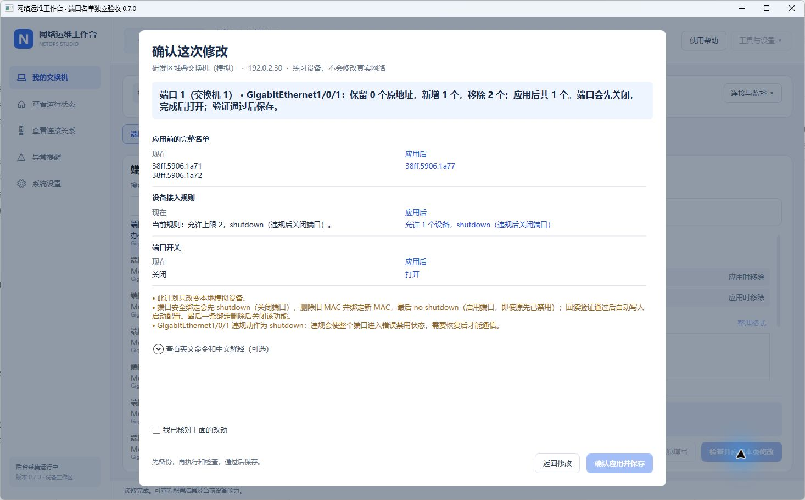

# 0.7 端口工作台与完整 MAC 名单

更新：2026-11-06。源码与本地构建版本 0.7.0；最新已发行下载包仍为 0.5.0。

## 为什么只填一条却显示三条

0.6 的“给端口绑定设备”按新增处理：端口原有两条绑定会保留，再加上输入的一条，最终确实是三条。但页面没有列出这两条旧地址；手动允许数量设为 1 后，只给出总数超限，用户无法判断应该保留谁或从哪里取消。问题是操作对象和修改范围不清楚，不能只把显示数字改成 1。

0.7 统一编辑完整名单：

| 页面内容 | 含义 |
| --- | --- |
| 原有地址，每条一个勾选框 | 勾选继续保留；取消勾选表示确认应用时移除 |
| 新增地址输入框 | 每行一个新地址，支持多行、横线、点号、冒号及连续 12 位 |
| 只用下面的新地址 | 取消保留全部旧地址，再输入希望使用的名单；确认前不修改交换机 |
| 固定数量说明 | 分别显示原有、保留、移除、输入、新增和最终条数；输入重复项不会重复计数 |
| 自动允许数量 | 默认随最终名单计算；一条就是 1，多条随之增加 |
| 手动允许数量 | 不足时解释具体来源，并可在固定区域点击“按名单自动设置”修正 |
| 确认页 | 同时展示完整原名单、完整目标名单及规则，不只显示一个总数 |

例如原有 A、B，填写新地址 C：保留 A、B 时最终是 A、B、C；选择只用新地址后最终只有 C。切换回来继续编辑时仍能看到各项选择；只有确认应用才会下发。

## 日常操作减少跳转

1. 从“我的交换机”点击“进入端口”，首次点击“连接并读取端口”。
2. 单击左侧端口。右侧“端口信息”直接填写名称、网络和开关；“MAC 绑定名单”编辑完整接入名单。
3. 点击固定的“检查并应用本页修改”，核对后确认。执行结果留在原页面，成功后显示实际回读值。

常用入口不再经过十张任务卡、选端口 / 填写 / 结果等分步页面。顶部固定“端口设置、网络（VLAN）、备份与记录、运行状态”。网络页左选网络、右改名或删除，新建有单独按钮；备份页直接备份，副本和操作记录各有列表。

完整批量端口配置、VLAN 成员矩阵、静态 MAC 转发和终端保留在设备页“更多端口功能”；AI 和批量草稿位于右上角“工具与设置”。英文厂商命令配中文解释，确认页默认收起命令细节。

## 其他页面如何使用

- 添加设备：资料与账户一页填写；选填资料和高级连接选项折叠。保存按钮始终在底部。
- 设备导航：当前页带蓝色选中背景；连接与监控属于当前设备，全局工具单独放置。
- 网络与备份：列表选择对象，右侧查看或修改；备份成功在本页提示，并新增可查看的副本。
- 运行状态与拓扑：保留趋势、来源和更新时间；总览统一使用“进入端口”，拓扑手工连接收进更多操作。
- 监控：先选采集方式、填必要账户；告警阈值和自定义指标按需展开，保存固定在底部。
- AI：选服务、查看将发送资料、填写问题；没有服务时可直接进入 AI 设置。配置保存按钮固定在底部。没有向外部服务发送测试数据。
- 批量导入和草稿仍作为高级功能保留，普通端口操作不要求使用它们。

## 修改范围和数据保护

- 只提交右侧当前页的实际变化：修改名称不会调整 MAC 数量上限，MAC 页输入也不会夹带另一页的未应用字段。
- 同一端口的名称、网络和开关可以在一次确认中提交。更换网络按已有适配逻辑保留普通静态安全绑定；原未修改的字段保留。
- 同一进程中切换端口会保留各端口未应用的填写，重新读取发现配置已变化时提示重新核对。它不是跨重启持久草稿。
- 普通操作不执行或清空其他批量草稿。返回修改会使旧审核计划失效，须重新检查后确认。
- MAC 绑定操作沿用关闭、移除旧绑定、设置规则、添加新绑定、打开端口、回读、保存顺序。最终为空表示解除 MAC 接入限制，不等于关闭端口。
- 本次不清空或重置用户工作区。桌面检查使用专门准备的独立模拟目录。

## 验证范围

148 项自动检查通过、0 项失败，Release 构建无警告、无错误。新增覆盖截图中的 2＋1 统计、手动上限不足、只用新地址后的实际一条名单、重复输入、端口填写隔离、只应用当前页、同页修改名称 / 网络 / 开关、清空 / 恢复名单、取消审核使计划失效、网络管理等。

WPF 实际渲染覆盖 780×430 内容区域下的固定应用按钮、完整名单审核、数量错误后的修正入口，以及新端口 / 网络 / 备份视图。真实设备兼容性、实际终端通断和其他电脑运行仍未认证。

本机自包含程序在独立练习工作区检查了一页添加设备、端口信息、旧名单 2＋新输入 1＝最终 3、只用新地址后的最终 1、完整名单确认与返回修改、网络及备份导航、模拟备份反馈、监控表单、AI 到设置的跳转。MAC 更换的实际执行由自动模拟检查覆盖，桌面预览未确认删除旧名单；未操作用户工作区或真实设备。

