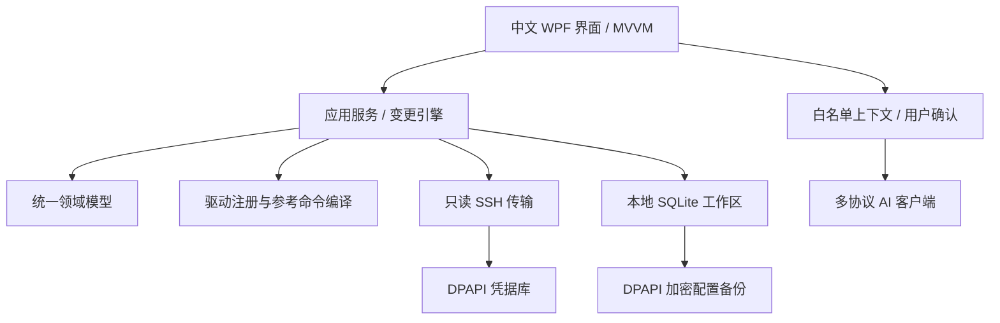

# 网络运维工作台：产品与架构

日期：2026-11-03。产品名称：NetOps Studio（网络运维工作台）。项目目录及 GitHub 仓库继续使用 Switch Tools / switch-tools。

## 需求来源与边界

依据用户提供的《网络配置平台构想》对话：面向网络工程师，以 C# 开发 Windows 桌面应用，通过统一图形界面管理交换机、路由器、防火墙；支持华为、H3C、Cisco、锐捷、TP-Link、Juniper、MikroTik、Ubiquiti 及后续品牌；规划 SSH、Console、Telnet、NETCONF、RESTCONF、厂商 HTTP API；提供高级命令行与主流 AI 接口辅助排障。界面、提示、项目文档、GitHub 说明与提交信息统一使用中文；技术标识符、协议名和厂商 CLI 保留原名。

对话最新方案在“跨厂商驱动兼容架构”开头结束，后续架构和里程碑由本项目补全，并非已有系统或已验证兼容性的证明。

## 产品原则

1. 统一模型承载端口、VLAN、设备与变更计划；厂商驱动承载原生语义，不以品牌名称推断所有功能可用。
2. 本地优先。设备档案、状态、审计存在本地 SQLite，凭据与原始备份使用 Windows 当前用户 DPAPI。
3. 配置路径：表单 → 参数/能力校验 → 基线绑定 → 差异与风险 → 人工确认 → 变更前备份 → 执行 → 回读验证 → 审计。
4. AI 仅提供只读建议。它没有 SSH 工具、任意命令入口或配置执行权限。
5. 模拟、实验性实现、实验室验证、真机验收分别记录，不能互相代替。

## 当前架构

| 层 | 责任 | 当前实现 |
| --- | --- | --- |
| `NetOps.Domain` | 设备、端口、VLAN、计划、备份、审计与 AI 配置 | 无第三方依赖 |
| `NetOps.Application` | 能力边界、参数校验、差异、风险、计划生命周期、接口契约 | 最新计划有效 10 分钟、单次消费、基线哈希 |
| `NetOps.Infrastructure` | SQLite、DPAPI、驱动、SSH、AI HTTP 协议 | 显式静态驱动注册；不加载任意外部插件 |
| `NetOps.Desktop` | 中文 WPF 窗口、MVVM、用户确认 | 深色桌面工作台与右侧 AI 助手 |
| `NetOps.Tests` | 可重复执行的功能验证程序 | 临时数据库、事务失败与模拟 HTTP 响应 |

采用 .NET 10 + WPF。本阶段使用 `Microsoft.Data.Sqlite`，避免小型初始数据模型引入额外 ORM；数据库显式记录模式版本 1，后续结构变化需增加顺序迁移。日志先以结构化本地操作审计提供，不记录密码、API 密钥或 AI 服务端错误原文。后续确有需要时再增加 EF Core、Serilog、依赖注入容器。

## 统一模型及扩展约束

- `Device` 保存厂商、型号、固件、角色、位置、管理 VLAN、SSH 端口、指纹与凭据引用；实际密码不能存入设备记录。
- `PortState` 区分接入、干道、混合、三层模式，保留 PVID、带标签 VLAN 和扩展字段；当前变更校验只开放接入/干道。
- 当前演示的 24 个端口是模拟夹具，不代表型号的真实端口数。示例地址使用文档保留网段 `192.0.2.0/24`。
- `ChangeRequest` 只能描述明确的配置意图。名称和描述采用受限字符集，不能将换行或命令片段拼接到 CLI。
- `ChangePlan` 对请求深拷贝；预览返回值不能修改执行引擎内部计划。新预览使旧计划失效。
- 模拟状态、变更前备份与审计在同一个 SQLite 事务提交，事务内再次检查基线与设备模式，避免并发覆盖及半完成状态。
- 后续真实驱动应匹配厂商 + 产品系列 + 固件范围 + 具体能力；未知组合默认不开放写入。

## 凭据和配置保护

默认目录 `%LOCALAPPDATA%\NetOpsStudio\data`，与 Git 工作区分离。DPAPI 密文与当前 Windows 用户绑定，不能只复制数据库就认定可在另一账户恢复。凭据库使用随机引用，不接受路径形式的引用。

设备档案、模拟结构化状态与审计当前不整体加密，仍包含网络资产信息，应使用受控 Windows 账户及磁盘访问权限。配置快照内容和实际密码/API 密钥已加密。没有遥测上传、后台扫描或自动设备连接。

## 真实设备连接的当前限制

SSH.NET 仅开放固定只读命令：版本、端口、VLAN、当前配置；界面当前开放版本读取和配置备份。必须预先填写从可信渠道核对的 SHA256 指纹，拒绝缺失或不匹配指纹，不自动接受首次主机密钥。当前只支持密码认证与 exec 通道。

分页标记、已知命令错误、空输出和非零退出码会导致读取失败；此检查不是完整解析器。某些设备只支持交互 Shell、无 exec 通道、权限模式特殊，当前不能兼容。备份保存 SSH 返回原文，不宣称已完成型号识别、配置语义解析或重启持久性验证。没有真实设备写入、真实配置恢复或自动回滚。

## AI 数据路径

可保存多个配置，独立支持 OpenAI 响应协议、Claude 消息协议、Gemini 内容生成协议、对话补全兼容协议、Ollama 本机协议；自定义模型编号与基础地址。DeepSeek、通义、豆包、智谱、Kimi 等兼容端点需以各自文档为准；不是每个供应商的专有 API 都已适配。Azure 专有部署路径未实现。

每次发送需要用户核对右侧目标地址与上下文，并勾选同意。上下文字段白名单只包含厂商、模拟端口状态和 VLAN 编号，不含管理 IP、位置、凭据、端口描述或原始备份。用户问题原文会发送，用户需避免在问题中填入秘密。真实档案尚无结构化实时状态时，不伪造模拟状态。切换设备、切换模型、完成请求后重新取消同意勾选。

远程 API 必须 HTTPS，本机地址可 HTTP；拒绝地址内嵌用户名、密码、查询参数和片段。HTTP 客户端拒绝自动重定向。每次请求有超时、取消和响应大小限制，不自动重试产生额外费用。只展示最终文本，丢弃独立的推理字段。没有流式输出、图片、工具调用、多轮对话或知识库。

## 官方技术资料

以下资料用于核对实现接口，不代表已连接真实服务：

- [.NET Windows 安装说明](https://learn.microsoft.com/zh-cn/dotnet/core/install/windows)
- [SSH.NET 官方示例及主机指纹核对](https://sshnet.github.io/SSH.NET/examples.html)
- [Windows DPAPI 使用说明](https://learn.microsoft.com/zh-cn/dotnet/standard/security/how-to-use-data-protection)
- [OpenAI 文本生成与响应协议](https://developers.openai.com/api/docs/guides/text)
- [Claude 消息接口](https://platform.claude.com/docs/en/api/messages/create)
- [Gemini 内容生成接口](https://ai.google.dev/api/generate-content)
- [DeepSeek 对话补全接口](https://api-docs.deepseek.com/api/create-chat-completion/)
