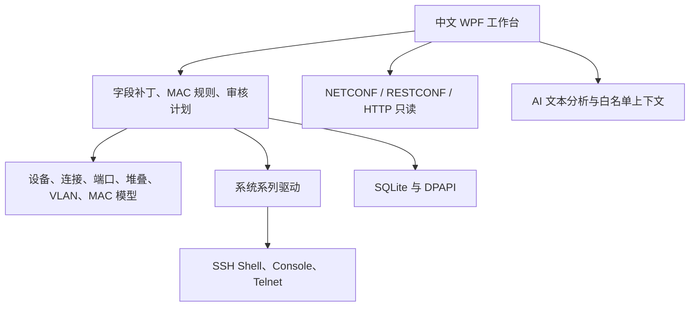

# 产品与架构

更新：2026-11-04；NetOps Studio 0.3.0。最初对话方案和具体交付状态见 [原方案需求对照](原方案需求对照.md)，不会将后续路线写成已交付。

## 正常操作路径

选择设备/连接 → 识别系统系列 → 读取运行配置、堆叠与接口 → 统一状态 → 单口/跨成员批量编辑 → 确定性校验 → 审核差异与命令 → 复核身份/配置/拓扑 → 备份 → 顺序下发 → 回读验证 → 可选保存 → 审计。

## 分层

Domain 提供结构化模型，Application 校验与生成一次性计划，Infrastructure 实现存储、传输、采集、解析、厂商命令与 AI，Desktop 负责交互。驱动静态注册，不加载任意 DLL 或执行 AI 命令。

## 浅色工作台与观测链路

0.3 将全局导航组织为网络总览、拓扑、设备中心、告警、待提交变更和系统设置。设备工作区保留当前设备与配置草稿；端口、VLAN 和 MAC 请求按设备排序投影到同一目标状态，审核时生成一份计划。直接编辑字段记录补丁，未编辑字段保留原值。浅色控件统一圆角下拉菜单、键盘焦点与细圆角滚动条。

独立 `--collector --workspace` 进程在同一 Windows 用户下读取已启用监控配置；命名互斥量防止同一工作区重复采集。最多并发 4 台，单设备周期硬超时 50 秒，心跳每 5 秒写入，独立停止标志可取消正在进行的采集。桌面每 5 秒刷新观测数据，配置基线和编辑草稿不随监控重置。

监控优先使用只读 SNMPv3 SHA256/AES128；v2c 或 SHA1 为明确选择的兼容项。HOST-RESOURCES-MIB CPU/物理内存、ENTITY-SENSOR-MIB 温度以及可选自定义标量 OID 与 SSH 输出转为带来源、单位、质量和可选成员编号的指标。标准表索引不冒充成员编号。设备可达性、指标失败、未支持、过期和维护独立表示。

SNMP LLDP 使用本地端口表匹配邻居，SSH 支持四家常见 LLDP 输出及 Cisco CDP；每 5 分钟刷新邻居。唯一标识匹配已纳管设备，双向边去重；自动邻居保留过期提示，手工连接单独标识并可移除。堆叠展开的点线仅表示成员关系，当前不提供真实端口运行状态、流量或物理堆叠线自动还原。

SQLite schema 2 以新增表保存监控配置、30 天采样、告警、拓扑、布局和采集器心跳，不覆盖原设备/配置/备份数据。监控凭据仍为 DPAPI 引用；本版没有常驻 Windows 服务、系统级开机启动或外部告警通知。

## 配置与状态

- 字段补丁：null 保留原值；空描述清除；仅修改描述不会重写端口模式、VLAN 或启停。
- 未读取时不能图形化配置；不能确定的模式标为未知兼容状态，仅允许独立描述与启停，不能推断 Access。
- 设备多连接档案保存协议、端口、指纹、串口参数/API 地址及凭据引用；原档案保留兼容读取。
- 堆叠与物理接口分别采集。接口简称匹配到配置中的原生名称，业务口/上联口计数，逻辑口排除；离线成员不生成可操作端口。常见固定式编号已支持，复杂机框需单独扩展。
- 统一状态携带采集时间、来源与未采集提示；配置哈希忽略链路和时间，包含端口、VLAN、MAC、安全策略；拓扑签名单独复核。
- 计划深拷贝、10 分钟有效、只执行一次，新编辑使旧计划失效。执行前比较设备身份、连接、配置基线和已采集拓扑。
- 模拟备份、状态与审计在单个 SQLite 事务提交。真实配置逐条下发，错误/取消停止，不自动重试或未验证回滚；可能部分生效时保留备份并明确提示。
- 运行配置验证通过后才发保存命令；“保存命令成功返回”不等于已通过重启持久性验收。
- MAC 静态转发与安全白名单独立；VLAN/成员冲突校验进入同一引擎。Cisco 白名单临时关闭接口，限制为明确接入口，不覆盖 sticky/其他安全与认证配置。

## 协议边界

SSH 是真实 GUI 配置的当前传输；Console/Telnet 提供用户手动登录与行式终端。NETCONF 当前只发 get-config，RESTCONF/HTTP 仅 GET；具体 YANG、路径、编辑事务与错误映射仍需驱动开发。没有完整终端仿真、自动提权、自动恢复或通用任意配置导入。

SSH/NETCONF 必须绑定可信 SHA256 指纹。Telnet 必须明确允许；API 远端 HTTPS、本机 HTTP 例外，禁用自动重定向。响应限制和超时防止无限等待；未解析的原文可查看和备份，不作为 GUI 可用基线。

## 数据与 AI

SQLite 保存资产/状态/审计；DPAPI 加密凭据、私钥、AI 密钥和备份内容，绑定当前 Windows 用户。结构化状态和档案仍包含网络资产，不整体加密。导入在事务中一次性提交，拒绝重复 IP；XLSX 不执行公式，不加载外部内容。

AI 仅接收用户问题和显示的白名单上下文，不上传管理 IP、位置、端口描述、MAC 原始清单、凭据或完整配置。已解析真实状态可带采集时间，未采集状态不伪造。每次发送前确认目标/内容；等待时浏览与编辑草稿可保留。仅展示最终文本，不提供设备工具调用。

## 参考资料

以下用于接口与语法核对，不代表相应设备已经验收：

- [SSH.NET 主机指纹与会话示例](https://sshnet.github.io/SSH.NET/examples.html)
- [H3C 静态 MAC 命令](https://www.h3c.com/en/d_202211/1722288_294551_0.htm)
- [Cisco IOS XE MAC 与端口安全](https://www.cisco.com/c/en/us/td/docs/switches/lan/c9000/lyr2-fwd/cdp-lldp-mac-udld/cdp-lldp-mac-udld-configuration-guide/c-configure-mac.html)
- [锐捷静态 MAC 与端口安全的区别](https://www.ruijie.com.cn/fw/wt/35638/)
- [H3C IRF 命令](https://www.h3c.com/cn/d_202009/1333724_30005_0.htm)
- [Cisco 堆叠读取命令](https://www.cisco.com/c/en/us/td/docs/switches/lan/catalyst2960xr/software/15-2_5_e/command_reference/b_1525e_consolidated_2960xr_cr/m_stck_cr.html)
- [华为 iStack 白皮书](https://enterprise.huawei.com/ucmf/groups/entpublic/documents/enterprise_webasset/hw_201070.pdf)
- [锐捷 VSU 故障排查与读取输出](https://image.ruijie.com.cn/Upload/Article/c15d3e02-0e6a-4e5a-b9da-1a21f200871e/%E9%94%90%E6%8D%B7%E4%BA%A4%E6%8D%A2%E6%9C%BA%E4%BA%A7%E5%93%81%E7%BA%BF%E9%97%AE%E9%A2%98%E4%B8%80%E6%9C%AC%E9%80%9A%EF%BC%88V1.0%EF%BC%89/%E4%BA%A4%E6%8D%A2%E6%9C%BA%E4%BA%A7%E5%93%81%E7%BA%BF%E9%97%AE%E9%A2%98%E4%B8%80%E6%9C%AC%E9%80%9AV1.0/e0acaf00-33bc-473c-b8ef-ee3686b306b1.htm)
