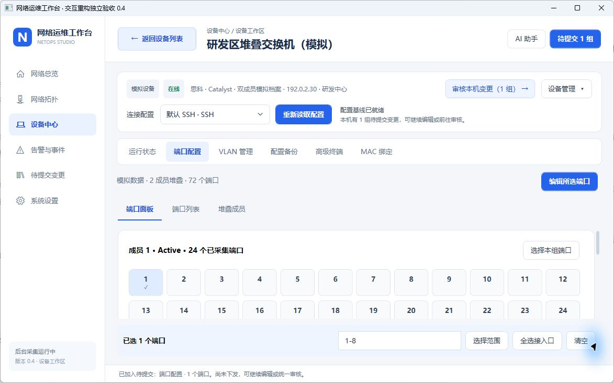
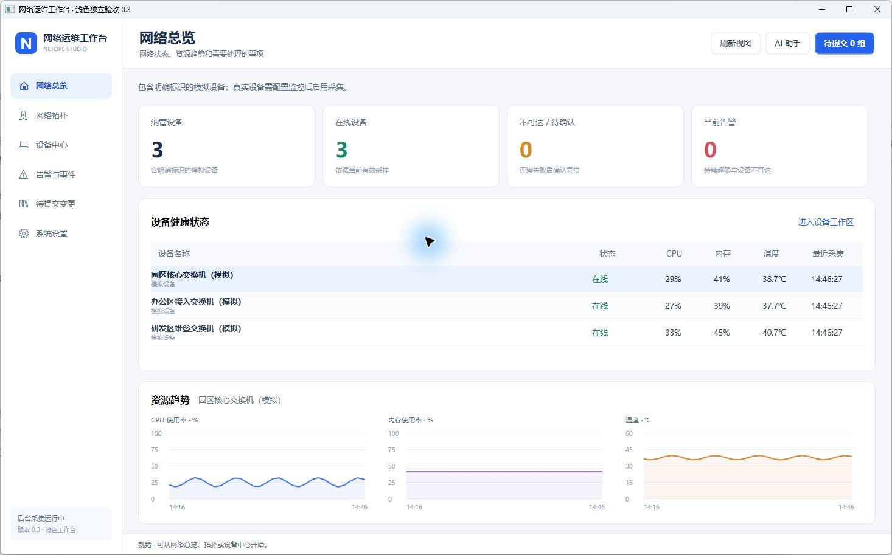
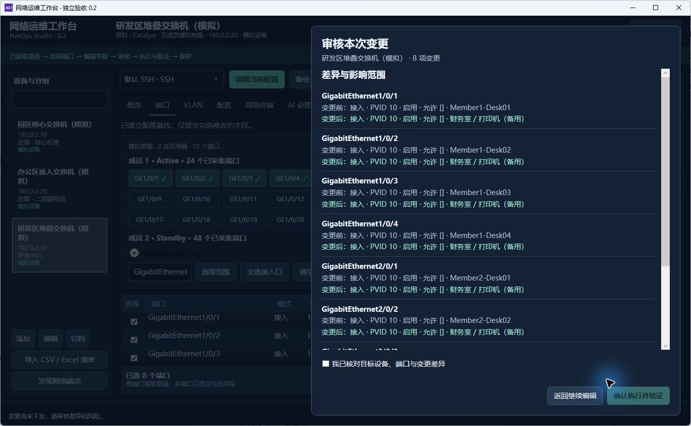
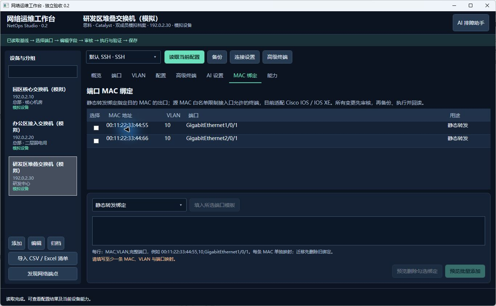

# 验证记录

更新：2026-11-05；源码版本 0.5.0。使用 Windows、.NET SDK 10.0.403、运行时 10.0.14。以下结果区分代码 / 会话夹具、桌面模拟与真实设备验收。

## 0.5 操作流程与 MAC 绑定

锁定依赖 Release 构建无警告、无错误，125 项通过、0 项失败。保留既有检查，补充 MAC 格式兼容、自动 / 手动上限、三种违规动作、一次换绑、按端口迁移顺序、删除后上限收紧、草稿隔离、任务入口、直接审核 / 取消 / 结果反馈和验证后强制保存。会话夹具覆盖设备拒绝安全 MAC 命令及配置回读不符时不保存。

本机自包含程序输出为 `artifacts/应用-v0.5.0/NetOpsStudio.exe`。独立模拟工作区桌面检查覆盖默认设备中心、六张任务卡、选择任务后引导读取、MAC 界面及中文违规下拉框；完成两条不同格式地址直接审核与模拟执行，回读显示上限 2，当前页展示完成结果。勾选旧地址后自动定位新 MAC 编辑格，换绑预览确认先关闭、删除旧地址、再添加新地址，没有执行真实设备命令。STA 渲染检查确认 900×360 内容区域中页底“下一步”按钮不越界。未连接真实交换机，未做物理终端通断认证。设计与操作步骤见 [0.5 操作重构](0.5操作重构.md)。

## 0.4.1 总览表格排版与显示绑定

锁定依赖 Release 构建 **0 警告、0 错误**，**109 项通过、0 项失败**。在原有 108 项检查上，新增 STA 线程实际加载应用资源与设备身份模板的回归检查：只读地址及来源可以正常显示；切换模拟/真实标识和地址后文本刷新；内容不超过 48 像素行高。测试只渲染数据，不创建网络连接或弹出窗口。

总览名称列设置 380 像素上限，指标列按比例分配，表头与数值居中；名称、管理地址统一左对齐及留白。地址和来源使用显式单向绑定，避免只读属性被双向绑定导致运行时异常。每行提供查看入口，保留选中联动趋势和双击进入工作区。

已启动 Windows x64 自包含版 `artifacts/应用-v0.4.1/NetOpsStudio.exe`，在独立模拟工作区检查三行内容完整显示和后台刷新。未连接真实设备或外部 AI。

## 0.4 导航与布局验证

锁定依赖 Release 构建 **0 警告、0 错误**，**108 项通过、0 项失败**。新增四项交互回归验证：返回列表保留筛选/端口选择/草稿，关键词与分组组合筛选及空结果清除，当前设备审核定位及队列保留，审核弹层打开时返回快捷命令不穿透。原有 104 项配置、监控、拓扑、会话与进程验证保留。

Windows x64 自包含发布包输出为 `artifacts/应用-v0.4.0/NetOpsStudio.exe`，已在本机独立模拟工作区启动。检查固定返回按钮、Alt+←、功能页切换、读取前后提示及较窄窗口中的导航。小窗口检查发现底部审核条挤压端口面板，最终改为准备区内的本机审核入口，并合并读取状态和下一步提示。

本轮未连接真实设备或外部 AI，未验证其他电脑与显示缩放比例。0.3 截图与结果保留为历史记录。

最终发布版在 1180×740 逻辑尺寸检查端口选择、编辑表单、加入队列与本机审核入口；加入变更后端口操作区保持原有高度。新版界面截图如下：

完成一条中文端口描述的桌面模拟闭环：读取双成员设备 → 选中端口 → 编辑描述 → 加入队列 → 本机入口定位 → 审核确认 → 模拟执行、备份与回读；执行后队列清空。此过程仅修改独立模拟数据。

## 0.3 新增自动验证

锁定依赖 Release 构建 **0 警告、0 错误**，**104 项通过、0 项失败**。保留此前 79 项配置、会话、堆叠及 MAC 检查，新增 25 项观测与操作流程验证：

- 监控配置边界、SQLite 增量持久化、可达/疑似/不可达/维护、有效零值与过期区分。
- 持续 CPU/内存/温度阈值、告警确认、不重复打开、回差恢复；缺失或断档历史不误报。
- 物理内存口径、ENTITY 温度单位/精度/状态、SSH 输出、明确的堆叠指标归属。
- LLDP 本地端口映射、四家 CLI 输出与 CDP、身份冲突不猜测、双向去重和布局保存。
- 本机 UDP SNMPv2c GET/GETBULK 实际报文往返；SNMPv3 代码构建通过，未做真实代理认证验收。
- 调度连续失败与恢复、维护暂停；真实独立子进程无窗口持续采集、同工作区互斥、停止信号退出。
- 采集长时间中断后重新累计失败次数，休眠前的疑似失败不会直接推成恢复后的离线告警。
- 跨页面创建 VLAN → 分配端口 → MAC 绑定统一审核；上游依赖移除后拒绝执行；直接编辑、草稿隔离和单次备份。
- 端口面板连续跨成员选择时不弹出编辑框；字段编辑会通知“加入待提交变更”按钮更新可用状态。
- 拓扑成员展开及端口定位、手工连接移除保护；从拓扑进入其他设备后，重复监控刷新保留当前设备、端口选择与草稿。

0.3 发布依赖锁已单独更新，新增 SharpSnmpLib 12.5.7；无数据库、密钥或采集凭据进入源码。

## 0.3 桌面与发布验收

在独立模拟工作区启动 Windows x64 自包含单文件版，检查浅色总览、资源趋势、拓扑节点选择、双成员展开、状态与配置分离。检查圆角下拉菜单的展开、选中效果与可输入 VLAN，检查细圆角滚动条。跨两个成员选择端口时面板保持可操作，点击编辑后直接填写中文描述；再由所选端口生成两行 MAC 映射，在表格编辑地址并加入同一设备队列。模拟提交后当前绑定列表回读两条对应不同成员的 MAC，待提交队列清空。所有示例地址均不发起真实网络连接。

关闭模拟桌面窗口后，独立采集进程仍运行；持续采样与停止退出另有自动进程测试覆盖。随后通过停止命令退出本轮验收采集器。发布输出为 `artifacts/应用-v0.3.0/NetOpsStudio.exe`，包含 Windows x64 运行时。其他电脑与真实交换机验收仍未完成。

## 0.2 历史验证

## 自动验证

`tools/验证.ps1` 锁定依赖还原成功，Release 构建 **0 警告、0 错误**，**79 项通过、0 项失败**。验证在独立构建目录运行，数据位于唯一临时目录；网络仅使用本机回环或会话/HTTP 夹具，不访问真实设备和 AI 服务。

覆盖：

- 配置步骤前置读取、字段补丁、混合值保留、跨设备草稿、备份与 AI 完成后保留选择。
- 中文描述直接编辑自动勾选、八端口独立变更、清除、控制字符/命令分隔符拒绝。
- VLAN 创建/重命名/引用保护/同步创建分配、范围校验、一次性计划、篡改/基线与事务竞争保护。
- 多连接、旧档案兼容、Console 无 IP、Telnet 显式允许与跨包协商、本机回环读写。
- 四厂商运行配置解析，未知模式不猜测；SSH 提示符与多页响应；未解析原文可备份但不开放 GUI。
- iStack/IRF/Cisco/VSU 成员解析、24/48 口混合计数、上联口计入、逻辑口/子接口排除、成员离线、跨成员范围与含糊裸范围拒绝。
- 真实执行路径夹具：自动接口/堆叠读取，成员更换时零写入；正常堆叠配置备份/下发/回读/保存顺序。
- MAC 归一化、无效单播、重复冲突、VLAN/端口关联、四厂商命令与回读、模拟持久化和删除；Cisco 白名单、上限/违规策略、最后一条删除和已有策略保护。
- 真实 MAC 或安全策略回读不符不保存，命令失败不重试；保存失败与验证成功分别报告。
- CSV/XLSX 中文/英文表头、共享/内联文本、公式/大文件拒绝、整批导入事务回滚、发现范围和取消。
- DPAPI 往返、数据库备份密文、AI 五协议请求/解析、默认配置、上下文白名单、错误脱敏、可信 SSH 指纹前置检查。

## 桌面实际操作

通过独立模拟工作区执行，不操作用户真实网络：

- 验证初始配置入口需要读取，AI 助手按需展开；多连接设备编辑对话框可访问。
- 第三台双成员模拟交换机显示 **24 + 48 = 72** 个端口，完整端口名区分同号端口。
- 范围 `GigabitEthernet1/0/1-4,GigabitEthernet2/0/1-4` 精确选中 8 个端口。
- 未先勾选“修改描述”直接输入“财务室 / 打印机（备用）”，预览入口启用，审核显示 8 项描述差异。
- 审核确认后模拟执行成功，回读显示中文描述，PVID/模式/启停保持原值，选择仍为 8 口。
- 在 MAC 页面为不同成员各填写一条 MAC/VLAN/完整端口映射，审核 2 项差异并执行，列表回读两条独立静态绑定。
- 此前完成 VLAN 同步创建与八端口 PVID 批量变更、自动/手动备份、审计和配置对比检查。

## 发布包

`tools/打包.ps1` 已锁定发布依赖，成功生成包含运行时的 Windows x64 单文件：`artifacts/应用-v0.2.0/NetOpsStudio.exe`。发布与普通构建锁文件独立，验证目录和发布目录独立；发布文件不提交到源码 Git。已在本机启动单文件版，重新读取同一独立工作区，确认两成员口数、中文描述与 MAC 绑定持久保存；成员统计展开时端口面板缩小，保留端口表与底部操作空间。

## 未验证范围

没有连接真实交换机、路由器、防火墙、串口设备或外部 AI 账号。尚未验证特定型号/固件兼容、真实 MAC 流量策略、实际堆叠热插拔、设备重启持久性、生产恢复/回滚或其他电脑运行。会话夹具与模拟数据不等于硬件验收。

0.1 的 32 项自动验证与旧端口截图是历史记录，不能代表当前 UI 或当前真实写入能力。
