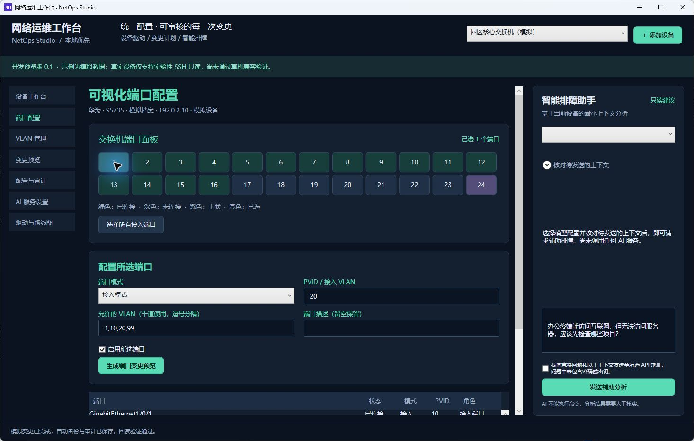

# 0.1 版本验证记录

日期：2026-11-03。环境：Windows x64，.NET SDK 10.0.403。验证数据全部是项目生成的模拟设备或临时夹具。

## 自动验证

`tools/验证.ps1` 执行锁定依赖还原、Release 构建与功能验证程序。32 项通过，0 项失败；构建 0 个警告、0 个错误。

覆盖以下实际行为：

- 首次初始化、重复初始化、SQLite 设备/状态持久化。
- 设备地址、管理 VLAN、SSH 端口合法性。
- VLAN 越界/重复、名称/描述命令注入、未知端口、PVID 不存在、空选择与干道允许列表约束。
- 预览不修改状态；确认前不能执行；执行前备份、状态更新与审计。
- 新预览替换旧计划、重复执行拒绝、基线变化拒绝、调用方不能篡改内部请求。
- 管理 VLAN/上联端口风险、无变化计划拒绝、真实设备执行隔离、未实现驱动/角色拒绝。
- 四类驱动参考命令分离、SQLite 事务竞争保护、失败事务整体回滚。
- DPAPI 凭据往返、禁止路径引用、备份不落明文。
- AI 上下文字段白名单、真实档案无数据时不伪造状态、地址校验与本机 HTTP 例外。
- 五类 AI 协议请求构造与响应解析，不展示独立推理字段；服务端错误不回显密钥。
- SSH 缺失可信指纹时在联网前拒绝请求。

HTTP 使用本地模拟响应，不包含真实 API 密钥。SSH 校验只验证本地前置约束，不建立网络会话。

## 桌面交互

通过 Computer Use 操作真实 WPF 窗口，核对以下流程：

| 操作 | 结果 |
| --- | --- |
| 启动中文工作台 | 三台模拟设备、中文菜单、深色主题正常显示 |
| 创建 VLAN 30 | 生成一项差异，展示华为参考命令 |
| 确认并执行 VLAN 计划 | 回读验证通过，VLAN 列表出现 30 |
| 选择端口 1 并配置 PVID 20 | 选择计数正确，差异显示从 VLAN 10 改到 VLAN 20 |
| 未勾选确认时执行 | 被拒绝，提示先核对变更与风险 |
| 确认并执行端口计划 | 回读验证通过，自动备份与中文审计存在 |
| 手动配置备份 | 增加一份加密保存的备份 |
| 对比变更前备份与当前模拟状态 | 显示版本变化以及 PVID 10 → 20 |
| 新增模拟设备 | 中文表单保存成功，未建立设备连接 |

界面检查期间修正了顶层窗口主题继承与初始滚动位置。另将数据行的辅助功能名称改为简洁中文摘要，避免辅助功能树默认包含整份配置内容。

## 打包与外部验收边界

`tools/打包.ps1` 生成包含运行时的 Windows x64 单文件程序，输出到被 Git 忽略的 `artifacts/应用`。打包成功不代表已在其他电脑或所有 Windows 版本验收。

已启动该单文件程序，在相同隔离工作区中核对四台设备档案（含桌面验收新增设备）仍存在，确认本机打包启动与设备档案重启持久化。

普通构建和单文件发布分开锁定 NuGet 依赖；已检查发布后仍能执行普通锁定依赖还原，避免打包改变开发与 CI 的依赖基线。

真实设备型号/固件、SSH 主机指纹匹配后的实际读取、Console/Telnet/NETCONF/RESTCONF、真实配置写入/恢复、AI 账号/模型与真实故障诊断均未验收。后续按 [开发与验收计划](开发与验收计划.md) 推进。
